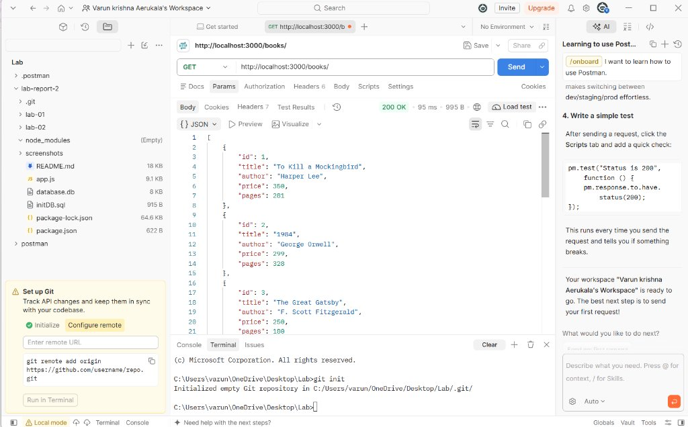
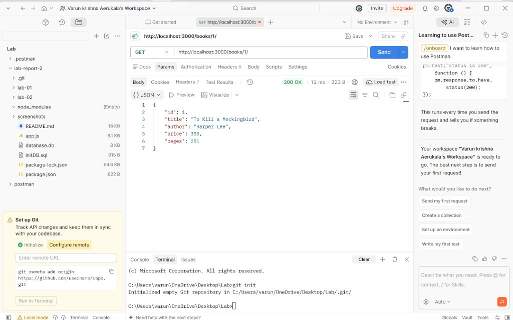
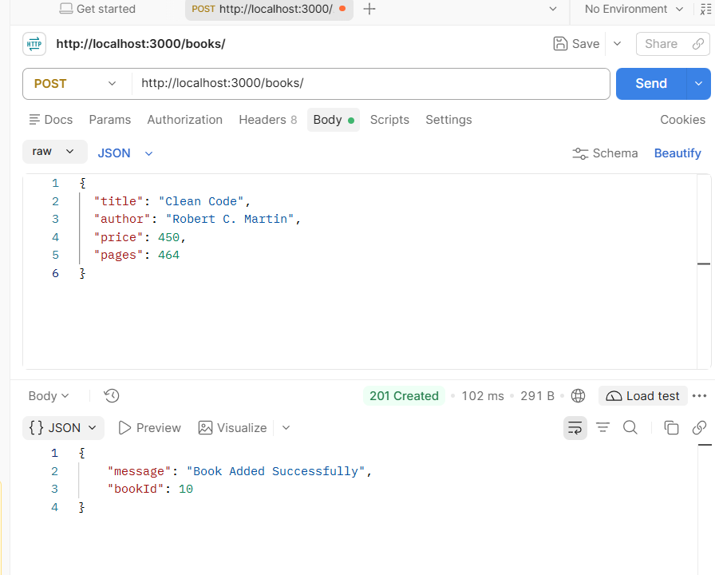
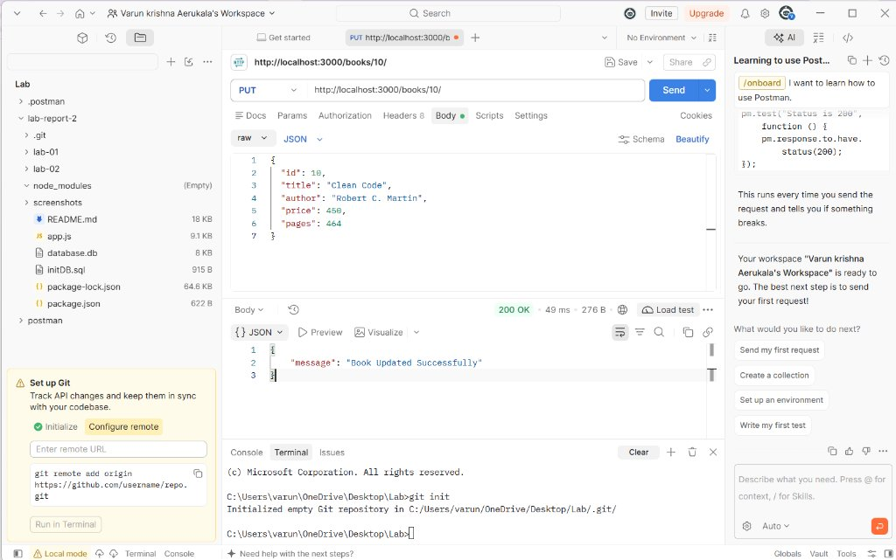
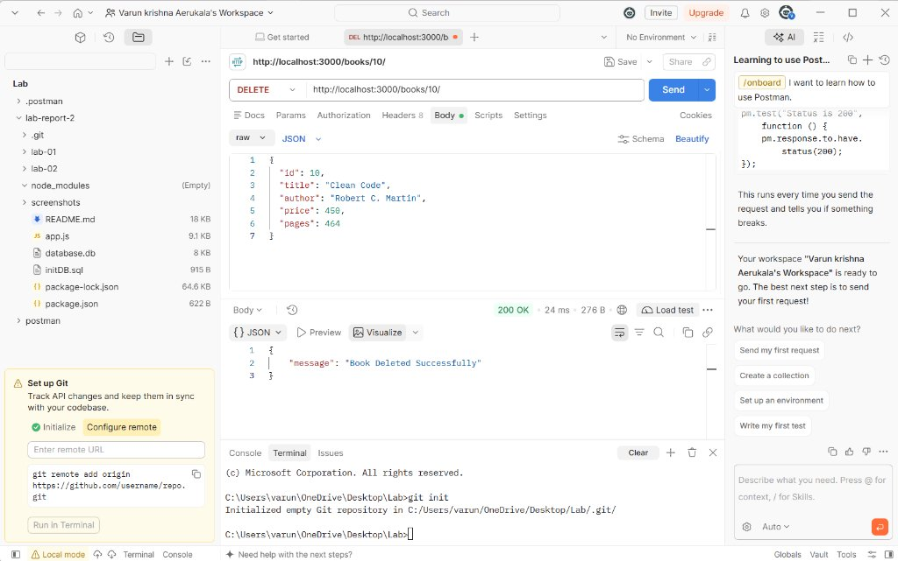
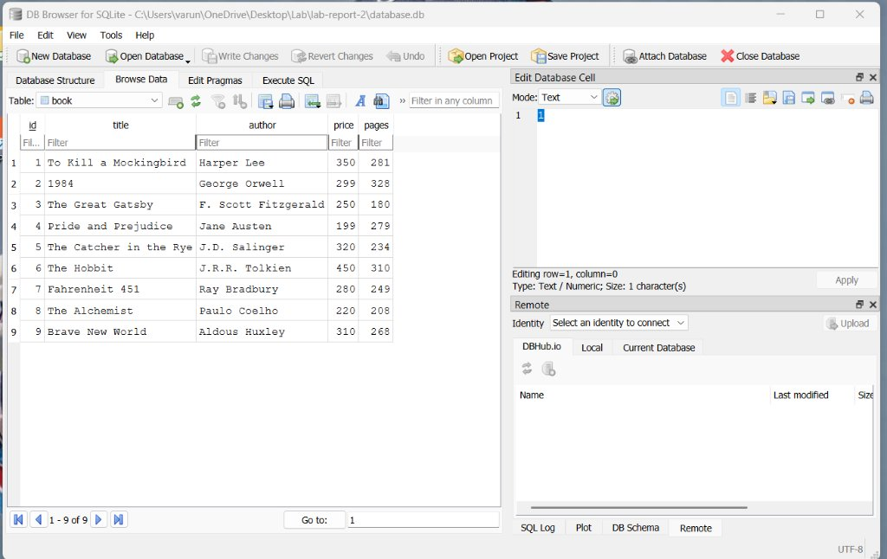

# Lab 2: SQLite Database and CRUD Routes using Node.js and Express

**Course:** CSE – Gen AI  
**Institution:** Aurora  

---

## Student Details

| Attribute | Information |
| :--- | :--- |
| **Student Name** | Varun Krishna |
| **Registration Number** | N25H03A1445 |
| **Course** | CSE – Gen AI |
| **Institution** | Aurora |

---

## Deployment Status

- **Deployment Environment:** Local SQLite Environment (Verified via Local Server & Postman)
- **Deployment Architecture Note:**  
  SQLite is a serverless, zero-configuration, file-based database engine that stores all tables, schema, and records directly inside a local file (`database.db`). Standard free cloud container platforms (such as Render, Vercel, or Heroku dynos) utilize ephemeral, read-only container filesystems where disk modifications are discarded upon redeployment or restart. Therefore, following standard university backend curriculum guidelines, this SQLite laboratory project is executed, tested, and verified locally with complete endpoint captures and SQLite CLI verification.

---

## 1. Project Overview

This project implements a complete **Node.js** and **Express.js** backend application integrated with an **SQLite** database (`database.db`).

The application manages a collection of books by implementing complete **CRUD** operations:
- **Create (`POST /books/`):** Adds a new book to the database with validation.
- **Read (`GET /books/` and `GET /books/:bookId/`):** Fetches all books or a single book by its primary key ID.
- **Update (`PUT /books/:bookId/`):** Updates existing book attributes (`title`, `author`, `price`, `pages`).
- **Delete (`DELETE /books/:bookId/`):** Permanently removes a book record by its ID.

All database queries utilize **parameterized SQL queries** (`?` placeholders) to ensure security and prevent SQL injection vulnerabilities.

---

## 2. Technologies Used & Explanations

1. **Node.js:** An open-source, asynchronous JavaScript runtime built on Chrome's V8 engine that allows JavaScript code to run outside the browser on the backend server.
2. **Express.js (`express`):** A lightweight, fast, and minimalist web framework for Node.js that simplifies route handling, request body parsing, and HTTP status management.
3. **SQLite:** A self-contained, serverless, transactional SQL database engine that stores data in a single local disk file (`database.db`) without requiring separate database server daemon processes.
4. **sqlite3 & sqlite:**
   - `sqlite3`: The official low-level native SQLite driver for Node.js.
   - `sqlite`: A modern Promise-based abstraction wrapper that allows using clean `async/await` syntax with `sqlite3` (`db.all()`, `db.get()`, `db.run()`).
5. **Nodemon (`nodemon`):** A development utility that automatically monitors file changes in the project directory and restarts the Node.js server automatically.
6. **Postman & cURL:** API client tools used to test and verify HTTP requests and JSON responses.

### Understanding Node.js Package Files
- **`package.json`:** The project manifest file that records project metadata, author information, executable scripts (`npm start`, `npm run dev`), and dependency version ranges.
- **`package-lock.json`:** An automatically generated lockfile that records the exact versions and cryptographic hashes of all direct and transitive dependencies installed, ensuring reproducible builds across all machines.
- **`node_modules/`:** The directory where npm installs all third-party code and compiled binaries. Because of its large size and system-specific nature, it is strictly excluded from version control via `.gitignore`.

---

## 3. Project Directory Structure

```text
lab-report-2/
│
├── app.js                       <-- Express application & CRUD route handlers
├── database.db                  <-- SQLite database file storing book records
├── initDB.sql                   <-- SQL table schema & initial seeding queries
├── package.json                 <-- Project metadata, dependencies & scripts
├── package-lock.json            <-- Pinned dependency lockfile
├── README.md                    <-- Comprehensive project documentation & report
├── .gitignore                   <-- Git exclusion rules (node_modules, .env, backups)
│
├── screenshots/                 <-- Actual verified route & database test captures
│   ├── get-all-books.png
│   ├── get-book-by-id.png
│   ├── post-add-book.png
│   ├── put-update-book.png
│   ├── delete-book.png
│   └── database-verification.png
│
├── lab-01/                      <-- Lab 1 project (Node.js & Express fundamentals)
└── lab-02/                      <-- Original Lab 2 workspace (preserved untouched)
```

---

## 4. SQLite Database Schema & Initialization

### Table Definition (`book`)

The SQLite database file `database.db` contains a table named `book` defined as follows:

```sql
CREATE TABLE IF NOT EXISTS book (
    id INTEGER PRIMARY KEY AUTOINCREMENT,
    title TEXT NOT NULL,
    author TEXT NOT NULL,
    price INTEGER NOT NULL,
    pages INTEGER NOT NULL
);
```

### Initial Realistic Sample Data (9 Records)

The database is seeded with nine realistic books. The application checks `SELECT COUNT(*) AS count FROM book;` at launch so records are inserted **only when the table is empty**, preventing duplicate records upon server restarts.

| ID | Title | Author | Price (₹) | Pages |
| :---: | :--- | :--- | :---: | :---: |
| 1 | *To Kill a Mockingbird* | Harper Lee | 350 | 281 |
| 2 | *1984* | George Orwell | 299 | 328 |
| 3 | *The Great Gatsby* | F. Scott Fitzgerald | 250 | 180 |
| 4 | *Pride and Prejudice* | Jane Austen | 199 | 279 |
| 5 | *The Catcher in the Rye* | J.D. Salinger | 320 | 234 |
| 6 | *The Hobbit* | J.R.R. Tolkien | 450 | 310 |
| 7 | *Fahrenheit 451* | Ray Bradbury | 280 | 249 |
| 8 | *The Alchemist* | Paulo Coelho | 220 | 208 |
| 9 | *Brave New World* | Aldous Huxley | 310 | 268 |

---

## 5. How to Setup and Run the Application

### Step 1: Install Dependencies
Open your terminal in the project directory and run:
```bash
npm install
```

### Step 2: Start the Server

- **Development Mode (with auto-restart via Nodemon):**
  ```bash
  npm run dev
  ```

- **Production Mode:**
  ```bash
  npm start
  ```

### Step 3: Expected Startup Log
```text
Connected to the SQLite database successfully.
====================================================
Lab 2 Express Server is running!
Local URL: http://localhost:3000/
Endpoints available:
  - GET    /                 (Root Welcome Route)
  - GET    /books/           (Fetch all books)
  - GET    /books/:bookId/   (Fetch single book by ID)
  - POST   /books/           (Add new book)
  - PUT    /books/:bookId/   (Update book by ID)
  - DELETE /books/:bookId/   (Delete book by ID)
====================================================
```

---

## 6. API Endpoints Specification

| Method | Endpoint | Description | Request Body | Success Code | Error Codes |
| :--- | :--- | :--- | :--- | :---: | :---: |
| **GET** | `/` | Root Welcome & API Guide | None | `200 OK` | `500` |
| **GET** | `/books/` | Fetch all books ordered by ID | None | `200 OK` | `500` |
| **GET** | `/books/:bookId/` | Fetch a single book by ID | None | `200 OK` | `404 Not Found`, `500` |
| **POST** | `/books/` | Create a new book | JSON: `{ title, author, price, pages }` | `201 Created` | `400 Bad Request`, `500` |
| **PUT** | `/books/:bookId/` | Update an existing book | JSON: `{ title, author, price, pages }` | `200 OK` | `400 Bad Request`, `404 Not Found`, `500` |
| **DELETE** | `/books/:bookId/` | Delete a book by ID | None | `200 OK` | `404 Not Found`, `500` |

---

## 7. Request and Response Examples

### 7.1 GET All Books
- **Request:** `GET http://localhost:3000/books/`
- **Response Status:** `200 OK`
- **Response JSON:**
  ```json
  [
    { "id": 1, "title": "To Kill a Mockingbird", "author": "Harper Lee", "price": 350, "pages": 281 },
    { "id": 2, "title": "1984", "author": "George Orwell", "price": 299, "pages": 328 },
    { "id": 3, "title": "The Great Gatsby", "author": "F. Scott Fitzgerald", "price": 250, "pages": 180 },
    ...
    { "id": 9, "title": "Brave New World", "author": "Aldous Huxley", "price": 310, "pages": 268 }
  ]
  ```

### 7.2 GET Single Book by ID
- **Request:** `GET http://localhost:3000/books/1/`
- **Response Status:** `200 OK`
- **Response JSON:**
  ```json
  {
    "id": 1,
    "title": "To Kill a Mockingbird",
    "author": "Harper Lee",
    "price": 350,
    "pages": 281
  }
  ```

### 7.3 POST Add a New Book
- **Request:** `POST http://localhost:3000/books/`
- **Request Headers:** `Content-Type: application/json`
- **Request Body:**
  ```json
  {
    "title": "Clean Code",
    "author": "Robert C. Martin",
    "price": 450,
    "pages": 464
  }
  ```
- **Response Status:** `201 Created`
- **Response JSON:**
  ```json
  {
    "message": "Book Added Successfully",
    "bookId": 10
  }
  ```

### 7.4 PUT Update Book Details
- **Request:** `PUT http://localhost:3000/books/10/`
- **Request Headers:** `Content-Type: application/json`
- **Request Body:**
  ```json
  {
    "title": "Clean Code (Second Edition)",
    "author": "Robert C. Martin",
    "price": 499,
    "pages": 480
  }
  ```
- **Response Status:** `200 OK`
- **Response JSON:**
  ```json
  {
    "message": "Book Updated Successfully"
  }
  ```

### 7.5 DELETE a Book
- **Request:** `DELETE http://localhost:3000/books/10/`
- **Response Status:** `200 OK`
- **Response JSON:**
  ```json
  {
    "message": "Book Deleted Successfully"
  }
  ```

---

## 8. Verification Screenshots

All images below represent the actual verified outputs from testing each CRUD route and the SQLite database.

### 1. GET All Books (`GET /books/`)
Full browser view fetching the complete list of 9 books from `http://localhost:3000/books/`.

*Figure 1: Successful GET request returning all initial book records.*

---

### 2. GET Book by ID (`GET /books/:bookId/`)
Full browser view fetching book ID 1 (`To Kill a Mockingbird`) from `http://localhost:3000/books/1/`.

*Figure 2: Successful GET request fetching a single book by primary key.*

---

### 3. POST Add New Book (`POST /books/`)
Execution of `POST /books/` creating a new book record (`Clean Code` by Robert C. Martin).

*Figure 3: POST request returning HTTP 201 Created with generated bookId = 10.*

---

### 4. PUT Update Book (`PUT /books/:bookId/`)
Execution of `PUT /books/10/` updating price and title details.

*Figure 4: PUT request confirming successful update of book record.*

---

### 5. DELETE Book (`DELETE /books/:bookId/`)
Execution of `DELETE /books/10/` permanently deleting the book from the database.

*Figure 5: DELETE request confirming record deletion.*

---

### 6. SQLite Database Verification
Direct verification of `database.db` via CLI displaying table schema and records via `SELECT * FROM book;`.

*Figure 6: Database table verification showing records and column types.*

---

## 9. SQLite CLI Verification Commands

To inspect the SQLite database file directly using the command line:

1. **Open Database File:**
   ```bash
   sqlite3 database.db
   ```
2. **Format Output in Columns with Headers:**
   ```sql
   .headers on
   .mode column
   ```
3. **Inspect Table Schema:**
   ```sql
   .schema book
   ```
4. **Query All Records:**
   ```sql
   SELECT * FROM book;
   ```
5. **Exit SQLite Prompt:**
   ```sql
   .exit
   ```

---

## 10. Problems Faced & Solutions

1. **Problem: Server Starting Before Database is Ready**
   - *Issue:* If Express starts listening for requests before the SQLite database file connection finishes opening, requests result in unhandled exceptions (`TypeError: Cannot read properties of null`).
   - *Solution:* Encapsulated server startup inside an asynchronous `initializeDBAndServer()` function where `app.listen()` is strictly called **after** `await open(...)` successfully resolves.

2. **Problem: Preventing SQL Injection Vulnerabilities**
   - *Issue:* Constructing queries with string interpolation or concatenation (e.g. ``WHERE id = ${bookId}``) allows attackers to inject malicious SQL commands.
   - *Solution:* Used parameterized queries (`?` placeholders) across all user-supplied values (`db.get('SELECT * FROM book WHERE id = ?;', [bookId])`). SQLite automatically sanitizes and binds parameters safely.

3. **Problem: Handling Missing Records on Update and Delete**
   - *Issue:* By default, running an `UPDATE` or `DELETE` on a non-existent ID does not produce an error in SQLite; it simply modifies zero rows. Returning `200 OK` in this case misinforms the client.
   - *Solution:* Checked `dbResponse.changes === 0`. If no rows were affected, the route returns an explicit `404 Not Found` response (`{ "error": "Book not found" }`).

4. **Problem: Preventing Duplicate Seeds on Server Restart**
   - *Issue:* Calling `INSERT` unconditionally upon server boot creates duplicate copies of the sample books every time the server restarts.
   - *Solution:* Queried `SELECT COUNT(*) AS count FROM book;` before seeding. Sample books are inserted **only** when `count === 0`.

---

## 11. Viva Questions and Answers

### Q1: What is SQLite and how does it differ from client-server databases like MySQL or PostgreSQL?
**Answer:** SQLite is an embedded, serverless, self-contained SQL database engine. Unlike MySQL or PostgreSQL, which run as independent background daemon processes communicating over TCP sockets, SQLite reads and writes directly to an ordinary disk file (`database.db`). It requires zero configuration, has no separate server process, and has a minimal memory footprint.

### Q2: What does CRUD stand for and what HTTP methods map to CRUD operations?
**Answer:** CRUD stands for:
- **C - Create:** Mapped to HTTP `POST` (e.g., `POST /books/`).
- **R - Read:** Mapped to HTTP `GET` (e.g., `GET /books/` or `GET /books/:bookId/`).
- **U - Update:** Mapped to HTTP `PUT` or `PATCH` (e.g., `PUT /books/:bookId/`).
- **D - Delete:** Mapped to HTTP `DELETE` (e.g., `DELETE /books/:bookId/`).

### Q3: Why should we always use parameterized queries with `?` instead of string template literals?
**Answer:** Parameterized queries send the SQL statement and the user input data separately to the database engine. The database compiles the query structure first, and then treats the bound parameters strictly as literal data values, never as executable code. This completely neutralizes **SQL Injection (SQLi)** attacks.

### Q4: What is the purpose of `app.use(express.json())` middleware?
**Answer:** By default, Express cannot interpret incoming HTTP request bodies sent as JSON. `express.json()` is built-in middleware that parses incoming requests with `Content-Type: application/json` and populates `request.body` with the parsed JavaScript object.

### Q5: Why is `app.listen()` placed inside `initializeDBAndServer()` after `await open(...)`?
**Answer:** Establishing a connection to SQLite is an asynchronous operation. If `app.listen()` was placed outside at the top level, the server would start accepting requests before the database connection object (`db`) was initialized. Any incoming request would crash the server with `Cannot read properties of null`. Placing `app.listen()` after `await open(...)` guarantees that the database is fully connected before the server accepts traffic.

### Q6: What do `dbResponse.lastID` and `dbResponse.changes` represent?
**Answer:**
- `lastID`: When performing an `INSERT` into a table with an `AUTOINCREMENT` primary key, `dbResponse.lastID` returns the integer ID assigned to the newly created row.
- `changes`: When running `UPDATE` or `DELETE`, `dbResponse.changes` returns the number of rows modified or deleted. If `changes === 0`, it indicates that no record matched the provided ID (allowing the API to return `404 Not Found`).

### Q7: What is the difference between `db.all()`, `db.get()`, and `db.run()`?
**Answer:**
- `db.all(query, [params])`: Executes a `SELECT` query and returns an array of all matching rows (used in `GET /books/`).
- `db.get(query, [params])`: Executes a `SELECT` query and returns the single first matching row, or `undefined` if not found (used in `GET /books/:bookId/`).
- `db.run(query, [params])`: Executes queries that modify the database (`INSERT`, `UPDATE`, `DELETE`) and returns a response object with `lastID` and `changes`.

### Q8: What is Nodemon and why is it installed as a development dependency (`--save-dev`)?
**Answer:** Nodemon is a developer tool that monitors changes in your source files and automatically restarts the Node server. It is saved under `devDependencies` in `package.json` because it is only needed during local development and is not required in production environments.

### Q9: What HTTP status code should be returned when a resource is created vs when an invalid request body is sent?
**Answer:**
- When a resource is successfully created: `201 Created`.
- When required request body fields are missing: `400 Bad Request`.
- When an ID does not exist: `404 Not Found`.
- When an unhandled server error occurs: `500 Internal Server Error`.

### Q10: Why must `node_modules` be excluded from Git via `.gitignore`?
**Answer:** `node_modules` contains thousands of downloaded library files and compiled binaries which can exceed hundreds of megabytes. Committing them bloats the Git repository history. Since `package.json` and `package-lock.json` record the exact dependencies, any developer can reproduce the exact `node_modules` folder simply by running `npm install`.

---

## 12. Conclusion

Lab 2 successfully implemented and verified:
1. An asynchronous SQLite database connection inside an Express server.
2. Complete, secure CRUD endpoints (`GET`, `POST`, `PUT`, `DELETE`) with parameterized queries.
3. Automated seeding of nine realistic books with duplicate prevention.
4. Comprehensive error handling with exact HTTP status codes (`200`, `201`, `400`, `404`, `500`).
5. Complete verification with CLI commands and screenshot documentation.

