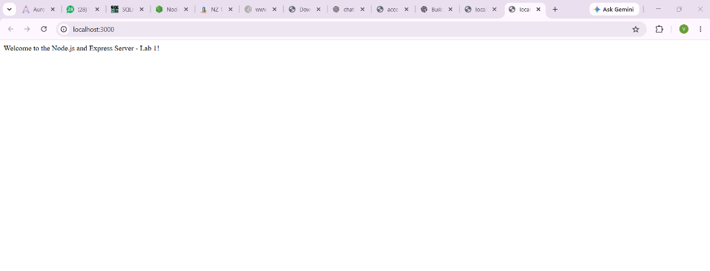
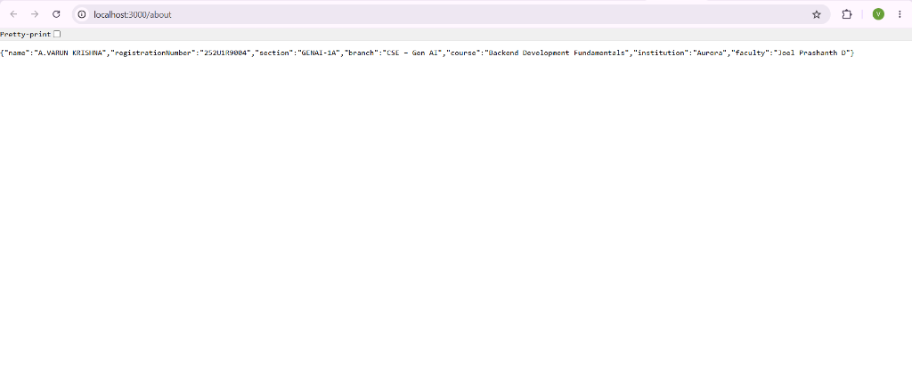
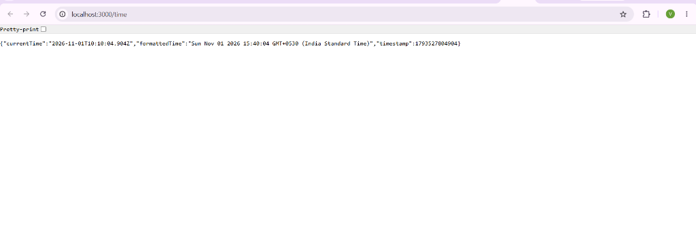
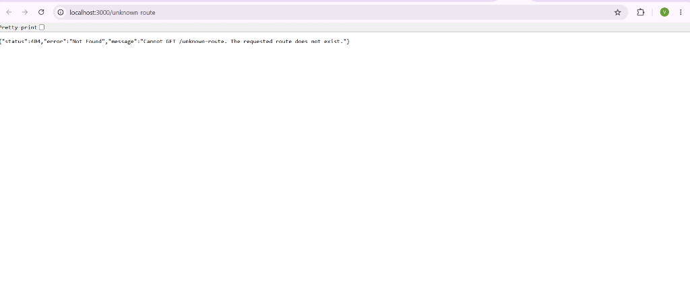
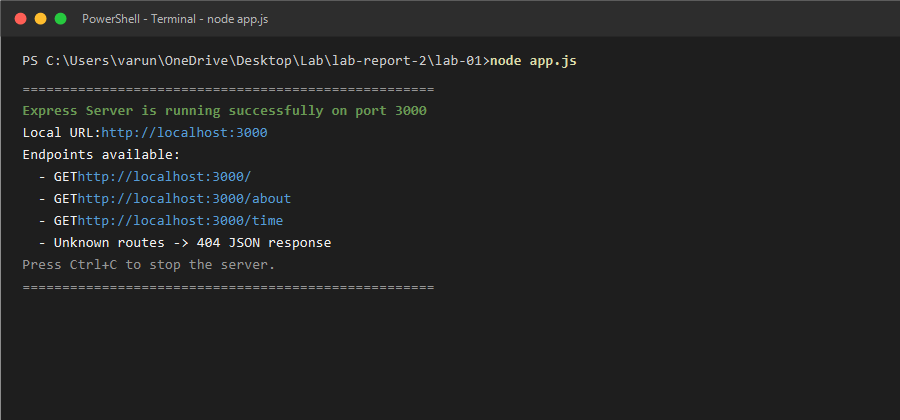

# Lab 1: Node.js and Express Server

**Course:** Backend Development Fundamentals (Year II · Term II)  
**Institution:** Aurora  
**Faculty:** Joel Prashanth D  

---

## Student Details

| Attribute | Details |
| :--- | :--- |
| **Student Name** | A.VARUN KRISHNA |
| **Registration Number** | 252U1R9004 |
| **Class & Section** | GENAI-1A |
| **Branch** | Computer Science & Engineering – Gen AI |
| **Academic Year** | Year II · Term II |

---

## Deployment Status

**Live Deployment URL:** `Not deployed yet`

> **Deployment Guide:**  
> To deploy this Express server to a cloud hosting platform such as **Render** or **Railway**:
> 1. Push your repository to GitHub.
> 2. Create a new Web Service on [Render](https://render.com) or [Railway](https://railway.app).
> 3. Connect your GitHub repository and set the **Root Directory** to `lab-01`.
> 4. Set the **Build Command** to `npm install`.
> 5. Set the **Start Command** to `npm start`.
> 6. The hosting provider automatically injects the `PORT` environment variable, which our application seamlessly adopts via `const PORT = process.env.PORT || 3000;`.
> 7. Once deployed, update the URL above with your live public URL.

---

## 1. Project Introduction

Backend web development forms the foundation of modern web and mobile applications. It handles business logic, client requests, authentication, and database transactions.

This laboratory project provides an introductory hands-on implementation of server-side programming in JavaScript using the **Node.js runtime** and the industry-standard **Express.js framework**.

The project consists of two key implementations:
1. **Plain Node.js HTTP Server (`server.js`)**: Demonstrates how Node.js creates a web server natively using its built-in `http` module without external dependencies.
2. **Express Application Server (`app.js`)**: Demonstrates how the Express framework simplifies server creation, request routing, JSON serialization, and centralized error handling (404 Not Found) with professional software development practices.

---

## 2. Objectives

The primary learning and practical objectives of this lab are:
- Understand the role of **Node.js** as an asynchronous, event-driven JavaScript runtime.
- Initialize and manage Node.js projects using **npm** (`npm init -y`).
- Distinguish between core Node.js modules and third-party packages installed from npm.
- Build a native HTTP server using `http.createServer()` listening on port 3000.
- Create an Express application utilizing `express()` and modular routing.
- Expose RESTful HTTP `GET` endpoints for root, about, and current server time.
- Implement proper HTTP status codes (`200 OK`, `404 Not Found`).
- Design an unknown-route fallback middleware returning structured JSON error responses.
- Configure port abstraction using `process.env.PORT || 3000` for seamless local development and production cloud deployment.
- Implement Git hygiene with `.gitignore` to prevent tracking `node_modules` and sensitive environment files.

---

## 3. Technologies Used

- **Runtime Environment:** [Node.js](https://nodejs.org/) (v20.x LTS)
- **Web Application Framework:** [Express.js](https://expressjs.com/) (v5.x)
- **Core Modules:** Node.js built-in `http` module
- **Package Manager:** npm (Node Package Manager v10.x)
- **Version Control:** Git & GitHub
- **API Testing Tools:** cURL, Web Browser, Postman

---

## 4. Project Folder Structure

The course repository is organized with dedicated folders for each laboratory assignment. `lab-01` is placed cleanly inside the parent repository alongside `lab-02`:

```text
lab-report-2/                        <-- Course Repository Root
├── .gitignore                       <-- Root Git ignore configuration
├── lab-01/                          <-- Lab 1 Project Directory
│   ├── .env.example                 <-- Template for environment variables
│   ├── .gitignore                   <-- Lab 1 Git ignore rules
│   ├── app.js                       <-- Express application server
│   ├── server.js                    <-- Plain Node.js built-in HTTP server
│   ├── package.json                 <-- Project metadata, scripts, and dependencies
│   ├── package-lock.json            <-- Exact dependency tree lockfile
│   ├── node_modules/                <-- Installed npm packages (git-ignored)
│   ├── README.md                    <-- Project documentation & lab report
│   └── screenshots/                 <-- Output verification screenshots
│       ├── 01-welcome-route.png
│       ├── 02-about-route.png
│       ├── 03-time-route.png
│       ├── 04-404-route.png
│       └── 05-terminal-running.png
└── lab-02/                          <-- Existing Lab 2 project (preserved intact)
    └── database.db
```

---

## 5. Node.js Project Architecture Explained

### 5.1 `package.json` Fields

The `package.json` file is the central manifest for any Node.js project. It records important metadata, scripts, and dependencies:

- `"name"`: The unique identifier of the package or project (e.g., `"lab-01"`).
- `"version"`: The current version following Semantic Versioning (`MAJOR.MINOR.PATCH`, e.g., `"1.0.0"`).
- `"description"`: A human-readable summary of the project’s purpose.
- `"main"`: The primary entry point script executed when the package is required or started (e.g., `"app.js"`).
- `"scripts"`: Key-value aliases for command-line tasks:
  - `"start": "node app.js"`: Starts the production Express server.
  - `"dev": "node app.js"`: Development run command.
  - `"plain-http": "node server.js"`: Executes the plain Node.js HTTP server.
- `"keywords"`: Descriptive tags for indexing and categorization.
- `"author"`: The developer or student who authored the project (`"A.VARUN KRISHNA"`).
- `"license"`: The legal licensing model under which the code is released (e.g., `"ISC"`).
- `"dependencies"`: Object mapping required third-party production npm packages to their semantic version ranges (e.g., `"express": "^5.3.0"`).

### 5.2 What is `node_modules`?

The `node_modules` directory is automatically generated when running `npm install`. It contains all the compiled JavaScript files, assets, and libraries required by Express and its transitive dependencies.

**Why is it never committed to Git?**
1. **Massive Size & File Count:** Even a basic Express install contains hundreds of sub-packages and thousands of files, which bloats repository history.
2. **Platform Specifics:** Certain dependencies may compile platform-specific C++ binary bindings that differ across Windows, macOS, and Linux.
3. **Reproducibility:** Anyone cloning the project can instantly regenerate the exact same `node_modules` folder simply by typing `npm install`, because `package.json` and `package-lock.json` record the exact dependency specifications.

### 5.3 What is `package-lock.json`?

`package-lock.json` is automatically maintained by npm upon any dependency alteration.
- While `package.json` allows version ranges (such as `^5.3.0` which accepts compatible future patches), `package-lock.json` pins down the **exact single version** installed for every direct and indirect dependency.
- It stores cryptographic integrity hashes (`sha512`) for every package to guarantee that all developers and deployment servers install the identical byte-for-byte code.
- It **must** be committed to Git to ensure deterministic, reproducible builds.

---

## 6. Installation & Setup Instructions

### Prerequisites
- Node.js (version 18.x, 20.x, or higher) installed on your system.
- Git installed on your system.

### Step 1: Open Terminal & Navigate to the Project
```bash
cd "C:\Users\varun\OneDrive\Desktop\Lab\lab-report-2\lab-01"
```

### Step 2: Install Project Dependencies
To install Express and all dependencies defined in `package.json`:
```bash
npm install
```

---

## 7. How to Run the Plain Node.js HTTP Server

The plain HTTP server (`server.js`) uses Node's native `http` module without any third-party frameworks.

### Step 1: Start the Server
Run either of the following commands:
```bash
npm run plain-http
```
*or directly with node:*
```bash
node server.js
```

### Step 2: Observe Terminal Output
```text
====================================================
Plain Node.js HTTP Server is running!
URL: http://localhost:3000
Response: "Hello"
Press Ctrl+C to stop the server.
====================================================
```

### Step 3: Test the Server
- **Browser:** Open `http://localhost:3000` in Google Chrome or Microsoft Edge.
- **cURL:**
  ```bash
  curl -i http://localhost:3000
  ```
- **Expected Output:**
  ```text
  HTTP/1.1 200 OK
  Content-Type: text/plain

  Hello
  ```
- Press `Ctrl + C` in the terminal to stop the server.

---

## 8. How to Run the Express Server

The Express application (`app.js`) provides structured routing, JSON output, dynamic port binding, and 404 error handling.

### Step 1: Start the Server
Run either of the following commands:
```bash
npm start
```
*or directly with node:*
```bash
node app.js
```

### Step 2: Custom Port Configuration (Optional)
The server respects the `PORT` environment variable. To run on port 5000:
- **Windows (PowerShell):**
  ```powershell
  $env:PORT=5000; node app.js
  ```
- **Linux/macOS (Bash):**
  ```bash
  PORT=5000 node app.js
  ```

### Step 3: Observe Terminal Output
```text
====================================================
Express Server is running successfully on port 3000
Local URL: http://localhost:3000
Endpoints available:
  - GET http://localhost:3000/
  - GET http://localhost:3000/about
  - GET http://localhost:3000/time
  - Unknown routes -> 404 JSON response
Press Ctrl+C to stop the server.
====================================================
```

---

## 9. API Endpoint Specification

| HTTP Method | Route / Endpoint | Description | Expected Status Code | Content Type |
| :--- | :--- | :--- | :---: | :--- |
| `GET` | `/` | Root route displaying a friendly welcome greeting | `200 OK` | `text/html; charset=utf-8` |
| `GET` | `/about` | Returns student details (name, reg number, section, branch) in JSON | `200 OK` | `application/json; charset=utf-8` |
| `GET` | `/time` | Returns the current server date, timestamp, and ISO string | `200 OK` | `application/json; charset=utf-8` |
| `ALL` | `*` (any unmatched) | Fallback 404 handler for non-existent paths | `404 Not Found` | `application/json; charset=utf-8` |

---

## 10. Request and Response Examples

### 10.1 Endpoint: `GET /` (Welcome Page)
- **Request:**
  ```http
  GET / HTTP/1.1
  Host: localhost:3000
  ```
- **Response Status:** `200 OK`
- **Response Headers:** `Content-Type: text/html; charset=utf-8`
- **Response Body:**
  ```text
  Welcome to the Node.js and Express Server - Lab 1!
  ```

---

### 10.2 Endpoint: `GET /about` (Student Profile)
- **Request:**
  ```http
  GET /about HTTP/1.1
  Host: localhost:3000
  Accept: application/json
  ```
- **Response Status:** `200 OK`
- **Response Headers:** `Content-Type: application/json; charset=utf-8`
- **Response Body:**
  ```json
  {
    "name": "A.VARUN KRISHNA",
    "registrationNumber": "252U1R9004",
    "section": "GENAI-1A",
    "branch": "CSE – Gen AI",
    "course": "Backend Development Fundamentals",
    "institution": "Aurora",
    "faculty": "Joel Prashanth D"
  }
  ```

---

### 10.3 Endpoint: `GET /time` (Current Server Time)
- **Request:**
  ```http
  GET /time HTTP/1.1
  Host: localhost:3000
  Accept: application/json
  ```
- **Response Status:** `200 OK`
- **Response Headers:** `Content-Type: application/json; charset=utf-8`
- **Response Body:**
  ```json
  {
    "currentTime": "2026-11-01T08:49:14.215Z",
    "formattedTime": "Sun Nov 01 2026 14:19:14 GMT+0530 (India Standard Time)",
    "timestamp": 1793522954215
  }
  ```

---

### 10.4 Endpoint: Unknown Route (404 Fallback Handler)
- **Request:**
  ```http
  GET /api/invalid-route HTTP/1.1
  Host: localhost:3000
  Accept: application/json
  ```
- **Response Status:** `404 Not Found`
- **Response Headers:** `Content-Type: application/json; charset=utf-8`
- **Response Body:**
  ```json
  {
    "status": 404,
    "error": "Not Found",
    "message": "Cannot GET /api/invalid-route. The requested route does not exist."
  }
  ```

---

## 11. Screenshots Section

*The screenshots below display the actual verified outputs from testing each endpoint and the terminal runtime.*

### 1. GET `/` Welcome Page

*Figure 1: Successful response for the root welcome endpoint returning HTTP 200.*

### 2. GET `/about` Student Information JSON

*Figure 2: JSON payload returning student name, registration number, section, and branch.*

### 3. GET `/time` Current Server Timestamp

*Figure 3: Current ISO 8601 timestamp and local date returned via `new Date()`.*

### 4. 404 Unknown Route Response

*Figure 4: Custom 404 JSON response for undefined routes returning HTTP 404 Not Found.*

### 5. Server Running Successfully in Terminal

*Figure 5: Terminal output showing the Express server running on port 3000.*

---

## 12. Problems Faced and Solutions

### Problem 1: Port Already in Use (`EADDRINUSE`)
- **Issue:** When restarting the Node.js server quickly or having an unclosed background process, the terminal throws: `Error: listen EADDRINUSE: address already in use :::3000`.
- **Solution:** Identified and terminated the conflicting process using PowerShell:
  ```powershell
  Get-Process -Id (Get-NetTCPConnection -LocalPort 3000).OwningProcess | Stop-Process -Force
  ```
  Additionally, configured dynamic port resolution using `process.env.PORT || 3000` so that any alternate free port can be specified without altering source code.

### Problem 2: Setting Headers After They are Sent
- **Issue:** Attempting multiple `res.send()` or `res.json()` calls inside a single handler causes: `Error [ERR_HTTP_HEADERS_SENT]: Cannot set headers after they are sent to the client`.
- **Solution:** Ensured each endpoint has a single termination point by immediately returning the response (e.g., `return res.status(200).json(...)`) or executing the send at the end of the request-response cycle.

### Problem 3: Default Express HTML 404 vs REST JSON Requirement
- **Issue:** By default, Express responds to unmatched routes with an HTML error page: `Cannot GET /unknown`. Modern REST APIs require structured JSON responses.
- **Solution:** Added a catch-all 404 middleware positioned strictly after all defined route handlers (`app.use((req, res) => { res.status(404).json(...) })`).

### Problem 4: Accidental Version Control Pollution
- **Issue:** The `node_modules` folder contains thousands of dependency files that should not be tracked by Git.
- **Solution:** Configured `.gitignore` at both the repository root and `lab-01` directory with `node_modules/` and `.env` rules before any Git commits were created.

---

## 13. Learning Outcomes

Through the completion of Lab 1, the following skills and understandings were achieved:
1. **Mastery of Node.js Runtime:** Gained clarity on how Node.js executes JavaScript on the server using Google Chrome's V8 engine and the libuv event loop.
2. **Package Management Competence:** Mastered `npm init`, dependency installation (`npm install express`), and lockfile mechanics.
3. **Low-Level vs. Framework Abstraction:** Understood the limitations of building large servers with plain Node `http` (manual URL parsing, manual content-type headers) versus the productivity gained using Express middleware and routing.
4. **REST API Design & Status Codes:** Mastered standard HTTP status codes (`200 OK` for valid GET requests, `404 Not Found` for nonexistent resources) and structured JSON error reporting.
5. **Production Readiness:** Configured applications for platform agnosticism with dynamic port assignment (`process.env.PORT`) and environment hygiene.

---

## 14. Viva Questions and Answers

### Q1: What is Node.js and how does it differ from JavaScript running in a browser?
**Answer:** Node.js is an open-source, cross-platform runtime environment built on Google Chrome's V8 JavaScript engine that allows developers to run JavaScript outside the browser. In a browser, JavaScript interacts with the Document Object Model (DOM) and the window object. In Node.js, JavaScript has access to server-side capabilities such as the file system (`fs`), network sockets (`http`), operating system APIs (`os`), and process controls (`process`), but lacks DOM APIs.

### Q2: What is the purpose of `http.createServer()` in Node.js?
**Answer:** `http.createServer([requestListener])` is a built-in method in Node's core `http` module that creates and returns a new HTTP web server instance. The `requestListener` callback function is automatically executed every time an HTTP request hits the server, passing `req` (an `http.IncomingMessage` stream) and `res` (an `http.ServerResponse` stream).

### Q3: Why do we use Express.js instead of building everything with the built-in `http` module?
**Answer:** While the native `http` module is powerful, writing a complete web application with it requires manual parsing of URLs, query parameters, HTTP headers, request bodies, and complex if/else ladders for routing. Express.js provides an abstraction layer featuring:
- Robust, declarative routing (`app.get`, `app.post`, etc.).
- Middleware pipeline architecture.
- Automatic content-type negotiation and JSON formatting (`res.json()`).
- High-level response helpers (`res.status()`, `res.send()`).
- Error-handling middleware.

### Q4: Explain the difference between `res.send()` and `res.json()`.
**Answer:** 
- `res.send()` is a versatile method that can send strings, HTML, Buffers, or objects. If passed a string, it defaults to `Content-Type: text/html`. If passed an object or array, it internally delegates to `res.json()`.
- `res.json()` explicitly serializes the passed JavaScript object or array into a JSON string using `JSON.stringify()`, automatically sets the `Content-Type: application/json; charset=utf-8` HTTP header, and ends the response.

### Q5: Why is `process.env.PORT || 3000` used instead of hardcoding port 3000?
**Answer:** In cloud hosting platforms (such as Render, Railway, AWS, or Heroku), applications are assigned a dynamic port at runtime via the environment variable `PORT`. Hardcoding `3000` causes the server to fail to bind to the host's required port, leading to deployment failure. Using `process.env.PORT || 3000` allows the server to use the cloud platform's assigned port when deployed, while cleanly falling back to port `3000` during local development.

### Q6: How does Express middleware work, and why must the 404 handler be placed at the bottom?
**Answer:** Middleware functions in Express are functions that have access to the request object (`req`), response object (`res`), and the `next` function in the application’s request-response cycle. Express processes middleware in the exact sequential order they are registered with `app.use()` or `app.METHOD()`. The 404 handler is placed at the very end because if an incoming request matches none of the preceding endpoints, execution flows to this final handler to return a 404 status. Placing it at the top would intercept and block all legitimate routes.

### Q7: What are HTTP status codes and what do 200 and 404 represent?
**Answer:** HTTP status codes are standardized three-digit integers returned by the server to inform the client of the outcome of its request:
- **`200 OK`:** Belongs to the 2xx class (Success). Indicates that the client's request was successfully received, understood, and processed.
- **`404 Not Found`:** Belongs to the 4xx class (Client Error). Indicates that the server could not find the requested resource or route.

### Q8: What is the significance of the `.gitignore` file in a Node.js project?
**Answer:** `.gitignore` specifies untracked files and patterns that Git should intentionally ignore. In Node.js projects, it is vital to ignore `node_modules/` (to avoid storing thousands of redundant vendor files) and `.env` (to prevent exposing sensitive secrets, API keys, and database credentials).

### Q9: What is the difference between `package.json` and `package-lock.json`?
**Answer:** `package.json` defines project metadata, scripts, and high-level version dependencies with flexible ranges (e.g. `^5.0.0`). `package-lock.json` provides an exact, deterministic snapshot of every single installed package, including transitive dependencies, specific versions, and cryptographic integrity checksums. This guarantees identical dependency resolution across different development machines and production environments.

### Q10: How does Node.js handle asynchronous operations in a single-threaded environment?
**Answer:** Node.js uses an event-driven, non-blocking I/O model powered by the **libuv** library. While JavaScript code runs on a single main thread (the Call Stack), asynchronous tasks (such as network requests, timer delays, or database file I/O) are offloaded to system kernel threads or the libuv worker pool. Once the asynchronous operation completes, its callback or resolved promise is placed into the Event Queue / Microtask Queue and executed by the Call Stack when it becomes empty.

---

## 15. Git Version Control History

The project follows clean Git practices:
- Root repository: `lab-report-2`
- Lab directory: `lab-01`
- Existing `lab-02` directory preserved untouched.
- No secondary `.git` repository initialized inside `lab-01`.
- Clean `.gitignore` ignoring `node_modules/` and `.env`.

---

## 16. Conclusion

Lab 1 successfully met all requirements specified by the faculty:
1. Created and configured the Node.js project environment using `npm init -y` and `npm install express`.
2. Implemented and verified a standalone plain HTTP server (`server.js`) responding on port 3000.
3. Created the production Express application (`app.js`) with dedicated GET routes (`/`, `/about`, `/time`) and a robust 404 fallback handler.
4. Validated exact HTTP status codes (`200 OK` and `404 Not Found`) across all endpoints.
5. Configured dynamic port binding with `process.env.PORT || 3000`.
6. Prepared a clean directory for actual screenshot verification.
7. Preserved the parent course repository and existing Lab 2 project without disruption.

The codebase is clean, well-commented, beginner-friendly, and fully prepared for evaluation and viva examination.