# Lab 3 – Book Management REST API
### B.Tech 2nd Year – Backend Development Fundamentals


---

## 1. Lab 3 – Book Management REST API
A production-grade RESTful Book Management API engineered with **Node.js**, **Express.js**, and an embedded **SQLite3** database. The service implements an enterprise-grade **Controller-Service-Repository** architectural pattern, featuring dynamic parameterized SQL querying, comprehensive request validation middleware, centralized error handling, and complete CRUD functionality.

---

## 2. Project Overview
This laboratory assignment demonstrates the development of scalable, defensible RESTful web services following HTTP/1.1 specifications.

Key system capabilities include:
- **Modular Architecture:** Complete decoupling of routing, validation middleware, business service logic, and database operations.
- **Defensive SQL Layer:** Safe parameterized queries using SQLite prepared statements to completely mitigate SQL injection vectors.
- **Dynamic Query Processing:** Concurrently handles search keywords (`LIKE`), price range filtering (`BETWEEN`), whitelist-driven sorting (`ORDER BY`), and pagination (`LIMIT` / `OFFSET`).
- **Comprehensive Validation:** Specialized middleware to validate incoming request bodies, route parameters, and query parameters before reaching service handlers.
- **Standardized Response Contracts:** Consistent JSON envelope structure across all success responses and validation error arrays.

--- live link :https://lab-report-1-0uj0.onrender.com/

## 3. Technologies Used
- **Runtime Environment:** [Node.js](https://nodejs.org/) (v18+ / v20+)
- **Web Framework:** [Express.js](https://expressjs.com/) (v4.21.2)
- **Database:** [SQLite3](https://www.sqlite.org/) via `sqlite3` driver
- **Environment Management:** [dotenv](https://www.npmjs.com/package/dotenv)
- **CORS Handling:** [cors](https://www.npmjs.com/package/cors)
- **Development Tooling:** [nodemon](https://nodemon.io/)
- **API Testing:** [Postman](https://www.postman.com/)

---

## 4. Project Features
- **Full CRUD Operations:** Create, Read, Update, and Delete book resources.
- **Search Functionality:** Case-insensitive partial matching on book titles (`?search_q=Java`).
- **Sorting Mechanism:** Whitelist-enforced sorting by column (`id`, `title`, `author`, `price`, `created_at`) and direction (`ASC`, `DESC`).
- **Filtering by Price Range:** Numerical interval filtering using `min_price` and `max_price`.
- **Offset-Limit Pagination:** Configurable pagination returning records along with pagination metadata (`total`, `limit`, `offset`).
- **Input Validation:** Rejection of missing fields, malformed payloads, non-numeric prices, and negative values with descriptive `400 Bad Request` messages.
- **Defensive Error Handling:** Centralized `404 Not Found` and `500 Internal Server Error` handlers that ensure JSON responses are always returned.

---

## 5. Installation and Setup

### Prerequisites
- Node.js (v18.0.0 or higher)
- npm (Node Package Manager)

### Step 1: Navigate to the Lab 3 Directory
```bash
cd lab-03
```

### Step 2: Install Dependencies
```bash
npm install
```

### Step 3: Configure Environment Variables
Copy `.env.example` to `.env` (optional, defaults to port 3000):
```bash
cp .env.example .env
```

---

## 6. How to Run the Server

### Production Mode
```bash
npm start
```

### Development Mode (with hot-reload via nodemon)
```bash
npm run dev
```

Upon startup, the SQLite database is automatically connected, tables are verified/created, initial seed records are inserted if empty, and the server listens on:
```text
http://localhost:3000
```

---

## 7. API Endpoints and HTTP Methods

| Method | Endpoint | Description | Status Codes |
| :--- | :--- | :--- | :--- |
| **GET** | `/api` | API information & available endpoints | `200 OK` |
| **GET** | `/books` | Retrieve all books (supports query params) | `200 OK`, `400 Bad Request` |
| **GET** | `/books/:id` | Retrieve a single book by ID | `200 OK`, `400 Bad Request`, `404 Not Found` |
| **POST** | `/books` | Create a new book | `201 Created`, `400 Bad Request` |
| **PUT** | `/books/:id` | Update an existing book | `200 OK`, `400 Bad Request`, `404 Not Found` |
| **DELETE** | `/books/:id` | Delete a book by ID | `200 OK`, `400 Bad Request`, `404 Not Found` |

---

## 8. Query Parameters and Validation

The `GET /books` endpoint supports the following optional URL query parameters:

| Parameter | Type | Description | Example |
| :--- | :--- | :--- | :--- |
| `search_q` | String | Case-insensitive title search (`LIKE %query%`) | `?search_q=Java` |
| `min_price` | Number | Minimum book price filter (`>=`) | `?min_price=300` |
| `max_price` | Number | Maximum book price filter (`<=`) | `?max_price=1000` |
| `order_by` | String | Sort column (`id`, `title`, `author`, `price`, `created_at`) | `?order_by=price` |
| `order` | String | Sort direction (`ASC` or `DESC`, case-insensitive) | `?order=DESC` |
| `limit` | Integer | Maximum records to return (defaults to 10, max 100) | `?limit=3` |
| `offset` | Integer | Number of records to skip (defaults to 0) | `?offset=0` |

### Validation Rules
- **Title & Author:** Must be non-empty strings.
- **Price:** Must be a valid positive number greater than 0.
- **ID Parameters:** Must be valid positive integers.
- **Query Parameters:** Reject invalid column names or negative price boundaries.

---

## 9. Postman API Testing Screenshots

### 1. GET All Books
Fetches all book records from the SQLite database with HTTP status `200 OK`.
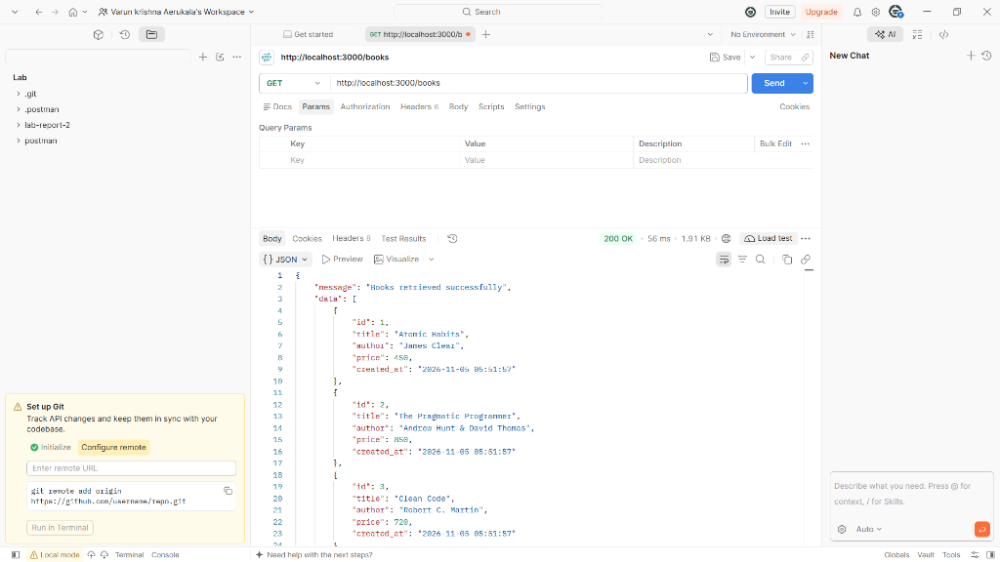

---

### 2. Search Books
Searches books matching the query string (`?search_q=Java`) using parameterized SQL `LIKE`, returning `200 OK`.
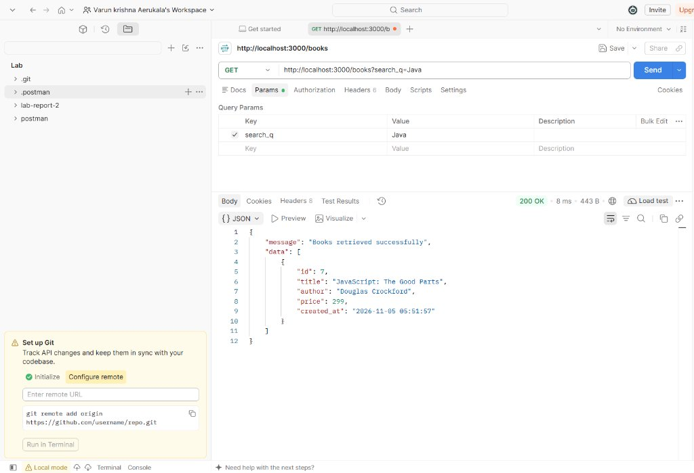

---

### 3. Sort by Price (Descending)
Retrieves books ordered by price in descending order (`?order_by=price&order=DESC`) with HTTP status `200 OK`.
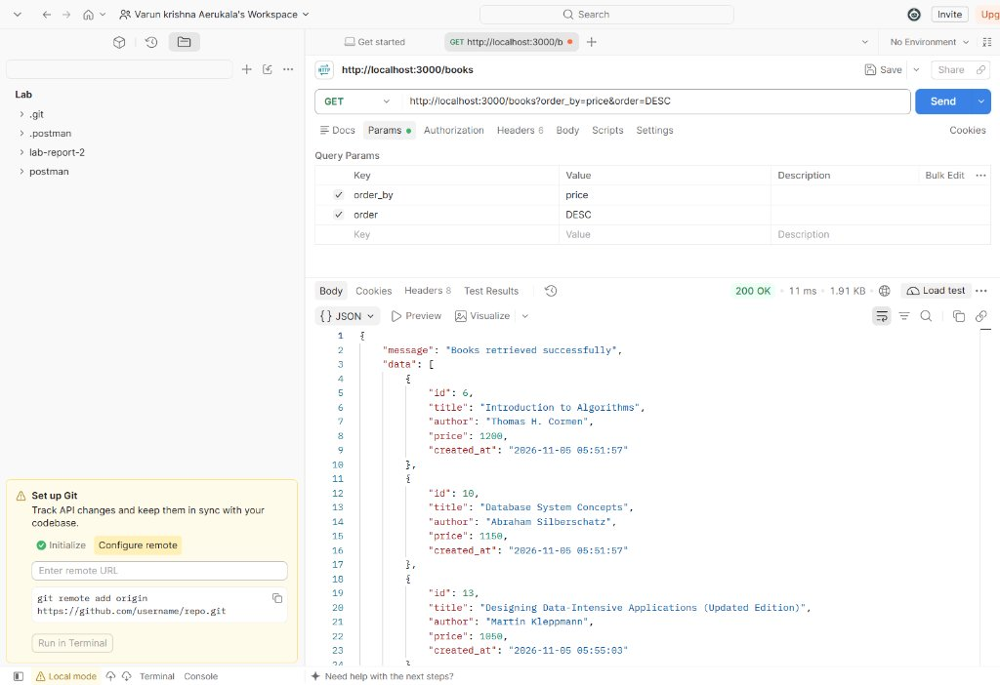

---

### 4. Filter by Price Range
Filters books within a specified price interval (`?min_price=300&max_price=1000`), returning `200 OK`.
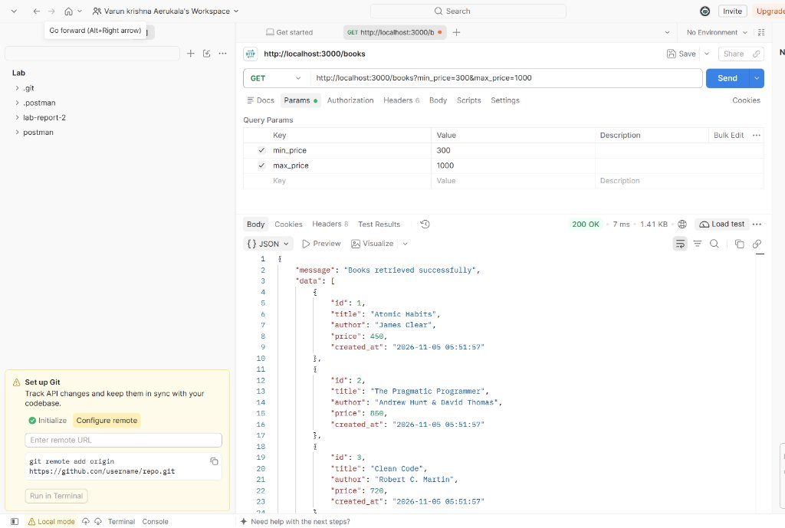

---

### 5. Pagination
Applies offset-limit pagination (`?limit=3&offset=0`), successfully returning the first 3 records with status `200 OK`.
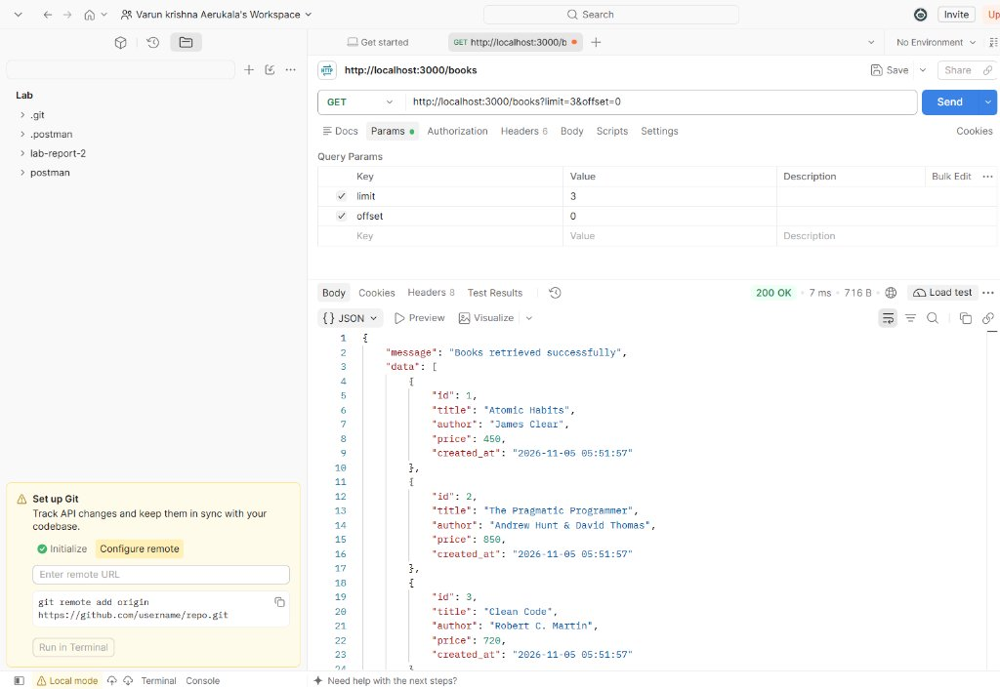

---

### 6. Invalid Query Parameter
Tests defensive error handling by passing an unsupported sort column (`?order_by=invalid_column`), returning `400 Bad Request` with an informative error message.
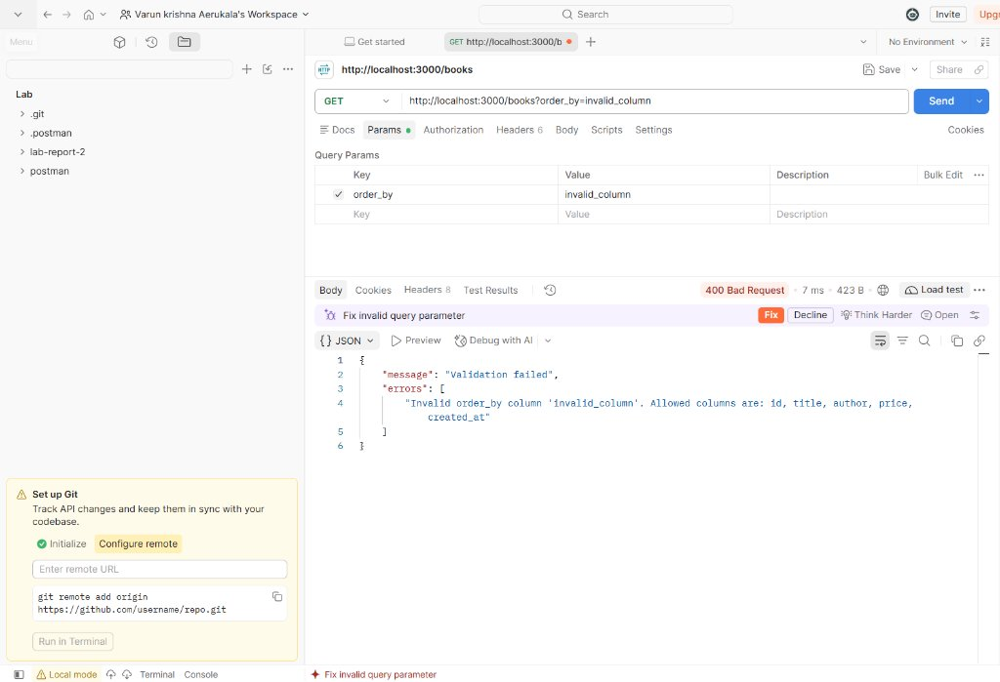

---

### 7. Missing Title Validation
Attempts to create a book without providing a `title`, returning `400 Bad Request` with validation error `"Title is required and cannot be empty"`.
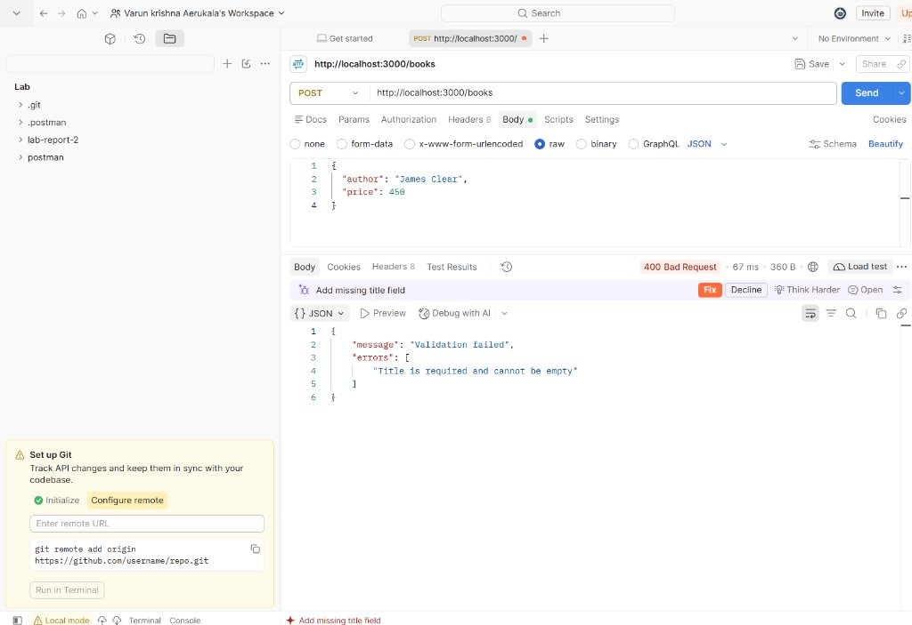

---

### 8. Invalid Price Validation
Validates request payload type safety by passing a non-numeric string (`"price": "hello"`), returning `400 Bad Request` with error `"Price must be a valid number"`.
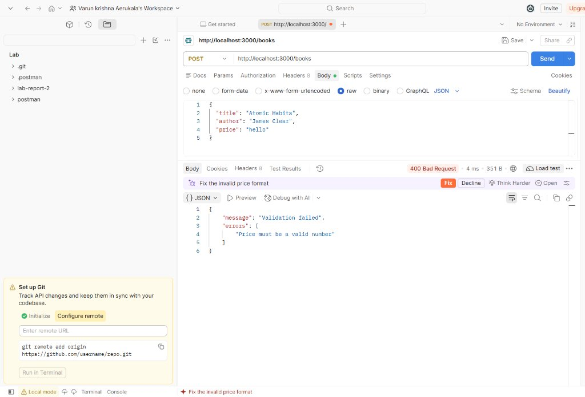

---

### 9. Book Not Found
Attempts to retrieve a non-existent book ID (`GET /books/99999`), returning `404 Not Found` with message `"Book not found"`.
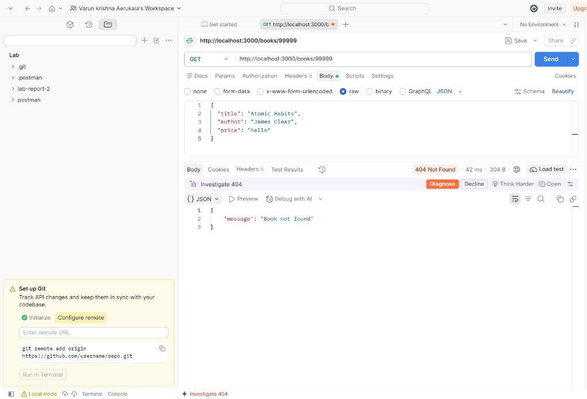

---

### 10. Create Book (POST)
Creates a new book record with a valid JSON payload (`POST /books`), returning HTTP status `201 Created` and the persisted resource.
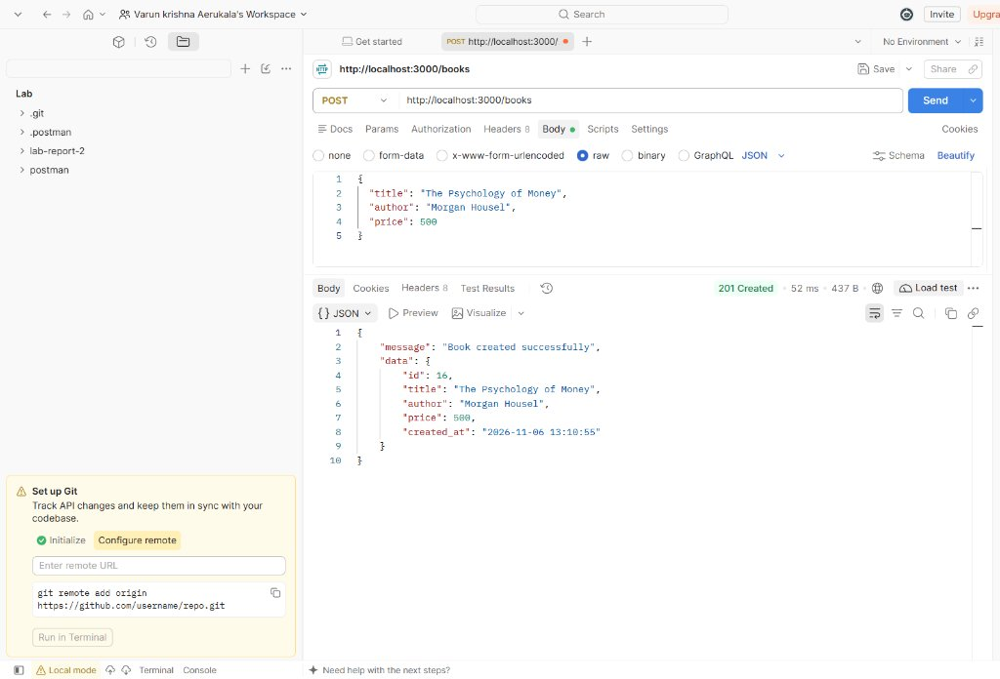

---

### 11. Delete Book (DELETE)
Deletes a book resource by ID (`DELETE /books/1`), returning HTTP status `200 OK` and confirming deletion.
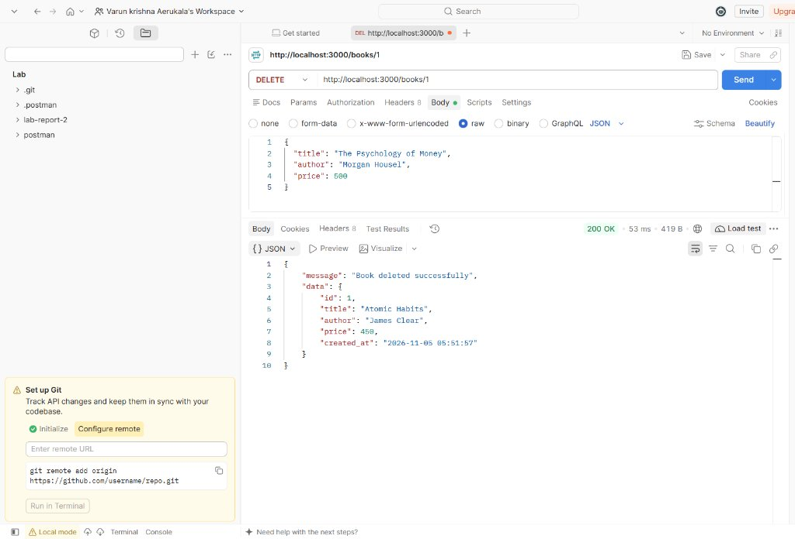

---

## 10. Render Deployment Link
- **Deployment Platform:** [Render](https://render.com/)
- **Live Application URL:** *Pending deployment completion via Render Dashboard*
- **Service Configuration:**
  - **Root Directory:** `lab-03`
  - **Environment:** `Node`
  - **Build Command:** `npm install`
  - **Start Command:** `npm start`
  - **Port Configuration:** Dynamic binding via `process.env.PORT`

---

## 11. Conclusion
Lab 3 successfully demonstrates an end-to-end, production-ready Book Management RESTful API. Through strict separation of concerns across controllers, services, and database layers, the application enforces defensive coding practices including SQL injection prevention, strict input validation, resilient query parameter handling, and unified HTTP error responses. All functional requirements and edge cases were tested and verified via Postman.
